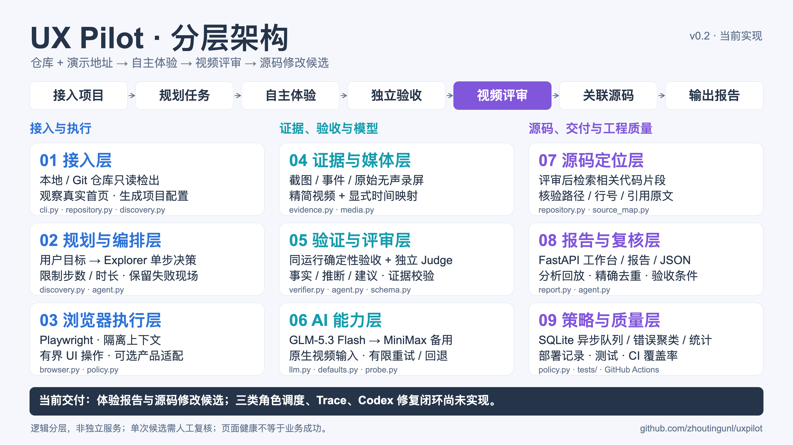
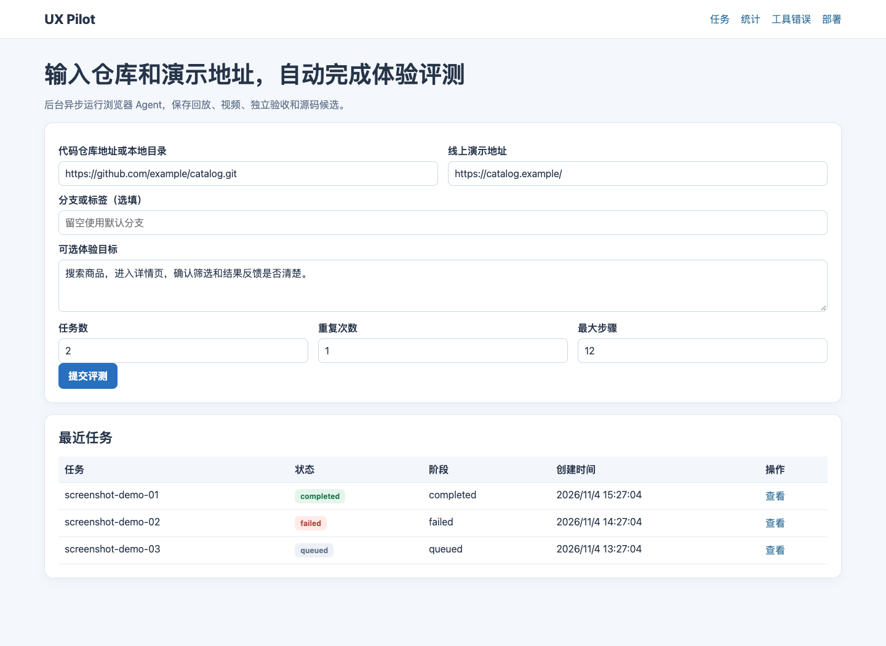
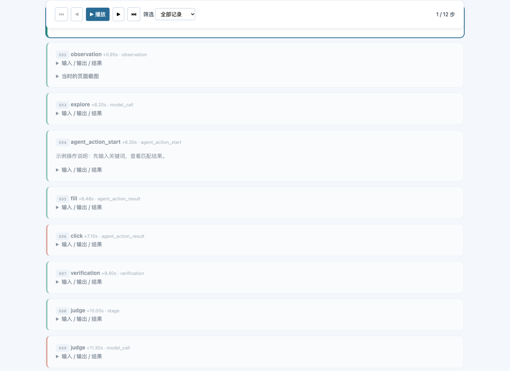
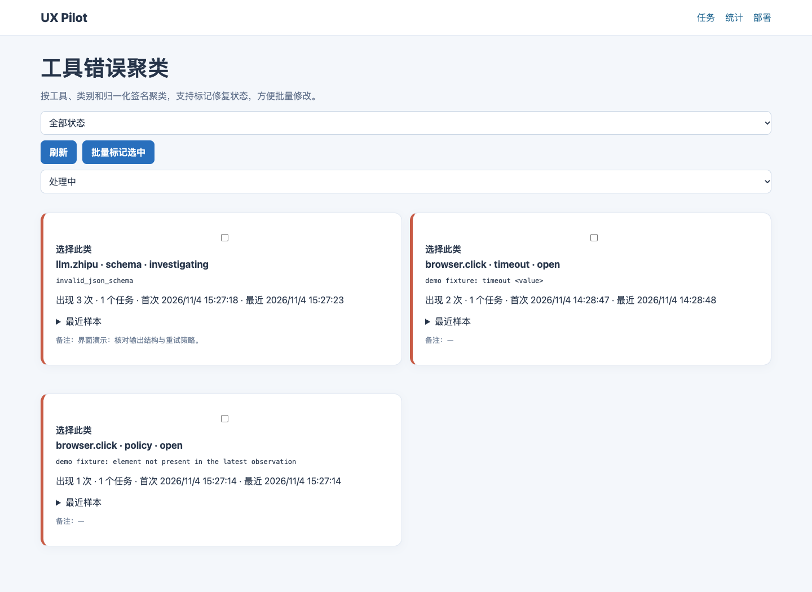

# UX Pilot

Give UX Pilot a code repository and a live demo URL. It plans user-oriented tasks, operates the browser, records evidence, reviews native video with an independent LLM call, and suggests changes with verified source references.

```bash
uv sync --frozen
uv run playwright install chromium
uv run uxpilot review \
  --repo https://github.com/markedjs/marked.git \
  --url https://marked.js.org/demo/

# 启动异步网站工作台
uv run uxpilot-web
```

Requires **Python 3.12+**, [uv](https://docs.astral.sh/uv/), Chrome (default), and `ffmpeg`/`ffprobe`. Install Chrome if it is not present (`uv run playwright install chrome`). Set `PLAYWRIGHT_CHROMIUM_EXECUTABLE` to a browser executable, or configure `browser.channel: null` to use Playwright's bundled Chromium. The `ai-ux` command remains an alias.

[中文说明](docs/README.zh-CN.md) · [异步工作台](docs/workbench.md) · [Architecture](docs/architecture.md) · [Validation](docs/validation.md) · [Coverage](docs/coverage.md)

[](docs/architecture.md)

[16:9 PNG for slides](docs/diagrams/architecture.png) · [Vector SVG](docs/diagrams/architecture.svg) · [Detailed overview](docs/diagrams/architecture-detail.png) · [Implementation status](docs/design-implementation-status.md)

## Async workbench

`uvicorn ai_ux.webapp:app` starts an SQLite-backed async workbench. The home page accepts a repository URL/path, live demo URL, optional goal, task count and repeats. Jobs claim one worker lock, survive page refreshes, and mark in-flight work `interrupted` after process restart; they never convert an interrupted run to success.

Pages:

- `/` submits a review and lists recent jobs.
- `/jobs` shows stage progress, cancellation, events, report links and analysis replay.
- `/stats` shows daily submissions, queue/execution/total latency distributions, model calls, known/unknown token counts and daily token totals.
- `/errors` clusters model/browser/page errors by tool, category and normalized signature; repeated deterministic clusters are marked candidates and can be triaged in batches (`open`, `investigating`, `fixed`, `ignored`).
- `/deploys` displays explicit release records, commit links, checks and coverage. Development startup is shown as development and does not create a success deployment.

Set `UXPILOT_DATA_DIR` for durable state, `UXPILOT_WORKERS` (default 1), `UXPILOT_MAX_QUEUED`, `UXPILOT_LOCAL_ROOTS` for allowed local repositories, and `UXPILOT_ALLOW_LOCAL=1` only for trusted local test environments. Public web mode validates public demo/repository hosts and allows only public GET/HEAD subresources; it is not a full network sandbox. Use a reverse proxy, authentication and a dedicated test account before exposing the workbench beyond localhost.

## Web interface

[View all screenshots](docs/screenshots/README.md) · [jfcs62 deployment and migration](deploy/README.md)



| Analysis replay | Tool-error clusters |
| --- | --- |
| [](docs/screenshots/README.md#分析回放) | [](docs/screenshots/README.md#错误聚类与统计) |

Screenshots show real application pages with isolated synthetic documentation data, not production evaluations or model benchmarks. The gallery also covers job details, statistics, deployment history and mobile layouts.

## Model configuration

Primary: **Zhipu `glm-5.3-Flash`**, streaming with `thinking: disabled`. Fallback: **MiniMax `MiniMax-M3.1-Flash`**, non-streaming, adaptive thinking and split reasoning. Both accept native video input; keys stay outside the repository.

| Provider | Environment variable | Default key file |
|---|---|---|
| Zhipu | `ZHIPU_API_KEY` | `~/.secrets/zhipu_api_key` |
| MiniMax | `MINIMAX_CN_API_KEY` | `~/.secrets/minimax_api_key` |

Run `uv run uxpilot doctor` to check credentials without printing them. API calls consume provider quota. `probe-video` submits a generated random-code video to both providers and checks their actual responses.

## Repository and demo review

```bash
# Local checkout, optional goal
uv run uxpilot review --repo /path/to/project --url https://demo.example.com/ \
  --goal 'Find an item and inspect its details'

# Generate an editable project profile first
uv run uxpilot review --repo https://github.com/org/project.git \
  --url https://demo.example.com/app/ --tasks 3 --plan-only

# Reuse the generated profile, add business assertions, repeat a task
uv run uxpilot --config artifacts/projects/<project-id>/project.yaml eval --repeats 3
```

- HTTPS and SSH Git URLs are cloned into the evaluation directory. Private repositories use existing non-interactive Git credentials. Local directories are read-only; no checkout, install, build, hooks, or submodule initialization is performed by the evaluator.
- Planning uses limited README/product documentation and an actual landing-page observation. Explorer receives the goal and current UI, **not source code or private assertions**. Judge runs in a fresh context. Source localization happens after UX judgement and checks path, line, and quote against the inspected source.
- Generic mode allows public HTTP(S) GET/HEAD subresources so normal CDN assets can load, while top-level navigation stays on the supplied host. Additional navigation hosts use `--allow-host`; known API/CDN hosts use `--resource-host`. Local/private literal IPs are blocked unless explicitly configured. This policy is not a network sandbox and does not implement DNS rebinding protection.
- Automatic checks cover readable pages, JavaScript errors, and horizontal overflow. They **do not prove business success**. Without configured task assertions the report says `task_outcome: not_verified`, and displays the independent Judge's assessment separately.
- Authentication, custom audio capture and domain-specific outcomes require configuration/adapters. Login barriers are reported, not bypassed. Use a test account/environment for workflows that modify persistent data.

## Reports and evidence

Each run writes an isolated directory under `artifacts/`. Outputs include:

- `report.html`, `report.md`, `report.json`: outcomes, evidence-based issues, reproduction steps, suggested changes, and regression acceptance criteria.
- `events.jsonl`, `observations/`, `screenshots/`: timestamped actions, visible UI, relevant errors, and browser evidence.
- `session.mp4`: full recording. DuckKing runs capture authorized test-microphone input and actual page Web Audio output into its audio track. `review.mp4`: compact recording with synchronized audio/video cuts that retain audible intervals. `video-timeline.json`: explicit mapping to the original clock.
- `verification.json`: deterministic checks independent of the Explorer's “done” response.
- `source-map.json`: verified source-reference candidates; not proof of root cause or deployed-version equivalence.
- `model-calls.json`, `manifest.json`: actual models, usage, failure/fallback outcomes, artifact hashes.

For recordings with audio, `judge.mp4` is a picture-identical silent copy used only by the vision models; humans play the audible `review.mp4`. GLM reviews that silent model copy. MiniMax's compatibility path reads continuous 4-second native-video segments and synthesizes their observations; final-segment padding is recorded. Original recordings are retained. Video remains 2 fps. Digital browser audio is not a physical speaker recording and cannot establish hardware volume or fast-motion accuracy. Historical silent videos remain labeled silent; audio is not invented from transcripts or untimed response PCM. See [audio recording](docs/audio-recording.md).

Retry only judgement after a provider outage:

```bash
uv run uxpilot --config artifacts/projects/<project-id>/project.yaml \
  judge artifacts/projects/<project-id>/runs/<batch>/<run>
```

Old assessments are archived. A failed run is retained, never presented as an initial success. Exit codes: 0 = pipeline completed (product tasks may fail), 2 = configuration/runtime/Judge failure, 130 = interruption.

## DuckKing adapter

The original project-specific profile remains available:

```bash
uv run uxpilot --config configs/duckking.yaml eval --task first-nod --task local-voice
```

It adds independent room ownership, real ASR/cloud voice through synthetic WAV input, model-first-frame checks and actual action results. It targets a public demo and can consume Lingxi voice quota. Generic review does not call DuckKing endpoints or assume its selectors. The voice fixtures contain system-generated speech, not human recordings.

The profile also includes English/French interface switching and cloud voice tasks:

```bash
uv run uxpilot --config configs/duckking.yaml eval \
  --task language-en --task language-fr \
  --task cloud-voice-en --task cloud-voice-fr
```

Chinese supports local-first recognition and cloud fallback; English and French use Lingxi cloud. Synthetic Mandarin, English and French WAV fixtures enter the browser's microphone capture path. The evaluator checks the current turn's transcript, actual motion results, assistant text, non-silent response PCM, turn completion and browser-reported playback counters. `page_language` checks the document language; localized text assertions check visible controls. `voice_session_language` checks the requested session language, not the spoken response language.

The configured GLM/MiniMax chat integrations send text, images and video. Separate MiniMax services now generate microphone input with `speech-2.8-hd` and independently transcribe the actual returned audio with `asr-1.0`. The DuckKing cloud tasks enable both through `speech` configuration and `audio.source: minimax_tts`; file fixtures remain supported. Each voice task makes at most one TTS and one ASR request in addition to browser/LLM/Lingxi calls. Credentials stay outside the repository and actual speech calls are included in model-call evidence.

`audio_received` establishes receipt of valid non-silent PCM; `audio_played` additionally requires a running browser audio context, completed playback frames, an empty queue and no new dropped frames. `response_speech` checks configured keywords in the independent ASR transcript. It snapshots only the latest spoken turn and rejects mixed-rate or incomplete PCM. Reports include the transcript, WAV playback and `speech-review.json`. These checks do not establish complete semantic equivalence, physical speaker audibility, pronunciation quality or real-user speech accuracy.

Run the deterministic interface matrix without model calls:

```bash
uv run uxpilot --config configs/duckking.yaml check-locales
# Narrow the scope while debugging:
uv run uxpilot --config configs/duckking.yaml check-locales --page index.html --viewport mobile
```

The default matrix covers ten pages, three languages, desktop and mobile (140 navigation/switch/reload cases). It operates the real language menu and checks key UI text, selected language, room/document/first canvas node preservation, non-Chinese cloud-mode restrictions, reload/cross-page persistence and horizontal overflow. It waits for asynchronous voice-mode initialization. Results, screenshots, events and recordings are retained under `locales-<batch>/`; `locale-report.html` lists each check. It does not exercise scene contents, release/restart or end-of-performance behavior, or establish complete translation and speech accuracy.

Run the separate scene lifecycle regression:

```bash
uv run uxpilot --config configs/duckking.yaml check-scenes
# Add native-video review using only the configured primary provider (GLM):
uv run uxpilot --config configs/duckking.yaml check-scenes --judge
# Debug just the release/restart path:
uv run uxpilot --config configs/duckking.yaml check-scenes --case release
```

This check loads and releases a ball scene, samples the idle state for five seconds, then checks that it can restart. It also plays act 07 in prerecorded rehearsal mode and checks that both canvas nodes remain visible for five seconds after completion. A successful restart or completed action does not override a failed final-state check. Screenshots, uncut recordings, individual checks and optional model review are retained in `scene-report.html` and `scene-report.json`; unavailable prerequisites remain `blocked`. Canvas presence alone does not prove correct 3D contents; review the images/video for that.

The duet may claim exactly one additional room, registered only after its allocation succeeds in the isolated browser context. Both owned scenes are conditionally released after browser shutdown; busy rooms are retained. Normal Explorer runs keep their existing single-room restriction. Scene checks block cloud voice connections and never call the speech services. With `--judge`, only `models.primary` is used, including on errors; the configured fallback is not contacted. Exit code 2 means a failed/blocked scene check or unavailable requested Judge, not a successful acceptance.

## Tests

```bash
uv sync --frozen
uv run pytest --cov=ai_ux --cov-branch \
  --cov-report=term-missing --cov-report=html:artifacts/coverage/html \
  --cov-report=json:artifacts/coverage/coverage.json
uv run ruff check src tests
uv run ruff format --check src tests
uv build
```

Tests include deterministic protocol doubles and actual local browser integration. They do not call paid model services or the public demo. GitHub Actions publishes HTML/JSON/XML coverage artifacts. Live model/site validations are documented separately; no API keys, recordings from third-party pages or private operational logs are committed.

## Scope

This is a report-oriented MVP, not an unsupervised agent for arbitrary production systems. It does not open issues, modify application code, deploy, or merge. Candidate findings and severities need review; title-based deduplication is exact rather than semantic. Task time includes model reasoning, so it must not be used as product latency. Source checkout and live deployment may differ. Use explicit assertions and adapters for strict business acceptance.

MIT licensed. See [THIRD_PARTY.md](THIRD_PARTY.md) for dependencies and attribution.
