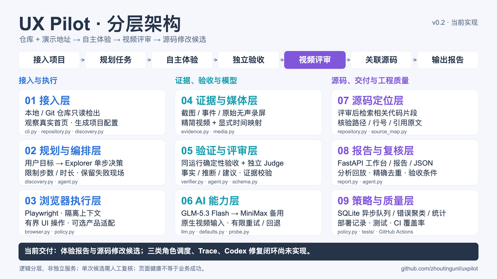
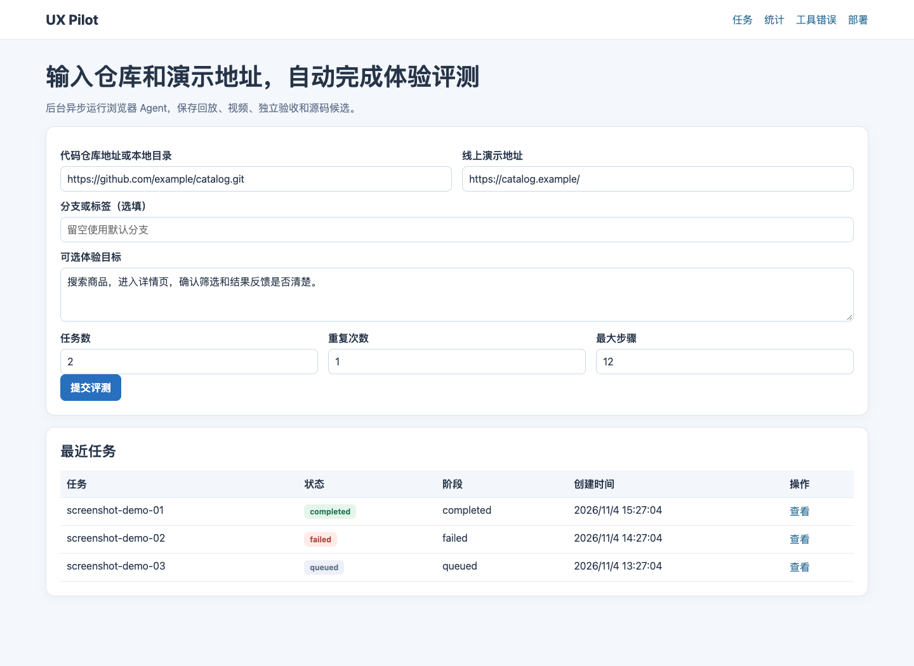

# UX Pilot 使用说明

提供**代码仓库地址（或本地目录）+ 线上演示地址**，即可自动规划体验目标、操作网页、保存截图/视频、独立评审并生成修改候选。默认模型是智谱 GLM-5.3 Flash，备用 MiniMax-M3.1 Flash。

[](architecture.md)

[16:9 横版 PNG](diagrams/architecture.png) · [SVG 矢量版](diagrams/architecture.svg) · [详细长图](diagrams/architecture-detail.png) · [原设计实现状态](design-implementation-status.md)

```bash
uv sync --frozen
uv run uxpilot review \
  --repo https://github.com/markedjs/marked.git \
  --url https://marked.js.org/demo/ \
  --tasks 3
```

默认使用本机 Chrome。也可安装 Playwright Chromium，再把生成配置的 `browser.channel` 改为 `null`，或设置 `PLAYWRIGHT_CHROMIUM_EXECUTABLE`。另外需要 ffmpeg/ffprobe。

密钥读取环境变量 `ZHIPU_API_KEY`、`MINIMAX_CN_API_KEY`，或仓库外的 `~/.secrets/zhipu_api_key`、`~/.secrets/minimax_api_key`；不写入报告。运行会消耗模型额度。

## 异步工作台

```bash
uv run uxpilot-web
```

打开 `http://127.0.0.1:8088/`，输入仓库地址和演示地址后后台异步运行。任务、阶段事件和报告保存到 `UXPILOT_DATA_DIR` 的 SQLite；进程重启会把运行中的任务标记为中断并保留证据。

`/jobs` 查看实时进度和分析回放，`/stats` 查看每日提交数、排队/执行/总耗时分布、模型调用和 token 用量，`/errors` 按工具、类别和归一化签名聚类错误并批量标记处理状态，`/deploys` 查看明确记录的发布版本、提交、验收检查和覆盖率。开发启动显示为 development，不会冒充成功发布。

生产使用前需在反向代理层增加认证，配置持久数据目录和测试账号；公网模式只允许公共目标和只读资源，不是完整网络沙箱。

## Web 界面截图

[完整截图集](screenshots/README.md)覆盖首页、任务详情、分析回放、工具错误聚类、统计、部署记录及手机布局。图片采用独立的合成演示数据，不包含服务器私有运行证据。



jfcs62 的兼容路由、持久状态迁移和发布方式见 [部署说明](../deploy/README.md)。

## 常用方式

```bash
# 指定本地源码和关注目标
uv run uxpilot review --repo /path/to/project --url https://demo.example.com/ \
  --goal '找到商品，搜索并查看详情'

# 只生成任务与配置，之后可补充严格业务断言
uv run uxpilot review --repo https://github.com/org/repo.git \
  --url https://demo.example.com/app/ --plan-only

# 复用生成配置，重复三次
uv run uxpilot --config artifacts/projects/<id>/project.yaml eval --repeats 3

# 模型故障后只重做评审，不重新操作网页
uv run uxpilot --config artifacts/projects/<id>/project.yaml \
  judge artifacts/projects/<id>/runs/<batch>/<run>
```

远程仓库检出到本次目录，本地仓库只读；不会安装依赖或启动目标源码。默认通用模式不使用 DuckKing 的房间、模型、语音等选择器。DuckKing 专用配置仍可单独运行。

## 如何解读结果

报告保存 `report.html`、`report.md`、`report.json`，包含实际观察、推断、建议、证据、复现步骤和回归标准。源码定位在体验结束后进行，并验证文件、行号和引用原文；这只说明位置相关，不代表根因或部署版本已经确认。

自动任务有页面加载、JS 错误和横向溢出的基础检查。**没有业务断言时，业务独立验收显示 `not_verified`；不会因为网页能打开就宣布任务成功。** Judge 对业务是否完成的判断单独展示。可配置 `text`、`element_visible`、`url_contains` 等断言，或加入专用适配器。

公开资源的 GET/HEAD 默认允许，用于正常加载 CDN；导航仍限制在配置域名内。额外导航域名用 `--allow-host`，资源域名用 `--resource-host`。登录、验证码、第三方支付和复杂富文本操作不是保证开箱即用的范围，必要时记录受限并补充测试配置。

原始录屏保留，评审精简视频会移除模型思考等待并提供时间映射。DuckKing 新录屏会保存测试麦克风输入和网页 Web Audio 输出音轨；精简版按相同边界剪切音画，并保留完整语音时段。2 fps 不用于高速物理动作验收，数字音轨也不等于真实扬声器实录。只有一次出现的问题保持 `needs_review`。

## DuckKing 多语言与语音

当前 GLM-5.3-Flash / MiniMax-M3.1-Flash 评测接口发送文字、截图和视频，没有直接发送音频或执行 ASR。产品语音功能仍然可以测试：合成 WAV → 浏览器麦克风 → DuckKing 真实识别／灵矽 → 动作与回复 → 独立验收。评测模型看界面、转写和协议证据。人工报告使用带声视频，视觉 Judge 使用同画面的无声 judge.mp4 副本，不声称模型听过语音。

已将 MiniMax 独立语音服务接入评测流水线：`speech-2.8-hd` 生成中英法麦克风输入，`asr-1.0` 独立转写实际回复。配置 `speech` 后，`audio.source: minimax_tts` 自动生成循环 WAV；保留 `source: file` 的已有样本。凭据复用 `MINIMAX_CN_API_KEY` 或仓库外 `~/.secrets/minimax_api_key`，可使用 M Plan 订阅 Key。每项语音任务最多增加一次生成和一次转写调用，实际调用进入模型用量与事件记录。

```bash
# 中文本地优先、中文云端与聊天回退
uv run uxpilot --config configs/duckking.yaml eval \
  --task local-voice --task cloud-voice --task fallback-chat

# 英法界面切换、刷新保持，以及真实英法语音
uv run uxpilot --config configs/duckking.yaml eval \
  --task language-en --task language-fr \
  --task cloud-voice-en --task cloud-voice-fr

# 十个页面 × 桌面/手机，140 项导航、切换和刷新场景；不调用评测模型
uv run uxpilot --config configs/duckking.yaml check-locales

# 只复查一个页面的手机布局
uv run uxpilot --config configs/duckking.yaml check-locales --page index.html --viewport mobile
```

中文支持本地优先；英语和法语直接使用灵矽云端。配置通过 `?lang=zh|en|fr` 明确界面／下一次连接语言，合成样本与目标语种对应。界面切换用例检查文档语言和关键按钮翻译；语音用例分别检查连接请求语言、本轮识别文本、实际动作、回答文本、非静音 PCM、回答结束和浏览器播放完成。

`audio_received` 证明本轮收到有效非静音 PCM；`audio_played` 检查浏览器播放完成；`response_speech` 验证独立 ASR 中的配置关键词，报告提供转写、WAV 试听和 `speech-review.json`。只截取最后一次说话后的回复，混合采样率、截断或尚未播完的音频不会算作通过。`voice_session_language` 只验证请求语言。**关键词通过不代表完整语义、发音或语种准确率，物理扬声器及真人口音／噪声表现仍需独立验收。** 通用 `review` 自动生成任务时没有配置语音夹具，不能据此声称已覆盖语音。

`check-locales` 通过真实语言菜单检查中文、英语、法语的关键文案、当前选项、房间保持、原地切换、画布保留、英法云端模式限制、刷新与跨页保持，以及手机语言入口和横向溢出。先等待异步识别模式初始化完成，再验收状态。输出 `locale-report.html/json`、逐步截图、事件与录屏；覆盖十页的关键界面，不代表所有翻译均正确。

[架构图](architecture.md) · [验证记录](validation.md) · [测试覆盖率](coverage.md)

音轨来源、同步、兼容范围及历史录像限制见 [音频录制说明](audio-recording.md)。
