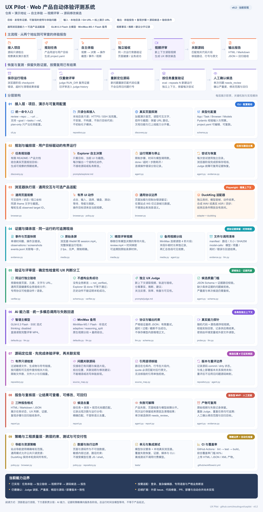
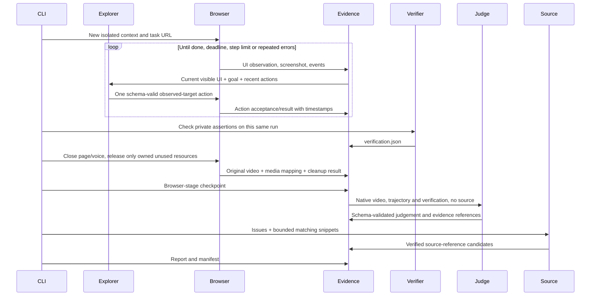
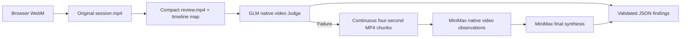

# Architecture

UX Pilot separates task planning, browser exploration, deterministic verification, UX judgement, and source localization. The default models are GLM-5.3 Flash with MiniMax-M3.1 Flash fallback. All roles use separate requests and bounded inputs; the Explorer never receives source code or private success assertions.

## Layered overview · 分层架构全景



[Full-resolution PNG](diagrams/architecture.png) · [Vector SVG](diagrams/architecture.svg) · [Local zoomable viewer](diagrams/architecture.html) · [Editable diagram content](diagrams/architecture.json)

The two top bands describe the main evaluation flow and evidence reuse. The nine layers group responsibilities: project intake, planning/orchestration, browser execution, evidence/media, verification/judgement, model providers, source localization, reporting/review, and cross-cutting policy/engineering quality. They are logical boundaries within the current Python CLI implementation, not separately deployed services. Purple cards indicate LLM roles; the tinted adapter card is optional DuckKing behavior. Source lookup follows UX judgement.

The HTML viewer opens locally and supports fit-to-window/full-size viewing and downloads. GitHub renders the PNG/SVG; it does not execute the HTML viewer. The diagram is generated from JSON with SVG text and vector icons, so labels remain editable and the SVG can be enlarged.

To regenerate both image formats after editing the JSON:

```bash
uv run python scripts/render_architecture.py
# Generate SVG/HTML only without launching a browser:
uv run python scripts/render_architecture.py --svg-only
```

PNG rendering uses Playwright and installed Chrome, or `PLAYWRIGHT_CHROMIUM_EXECUTABLE`. Use a CJK-capable system font for Chinese labels. No model calls or network requests are needed to render the documentation.

## Components

| Module | Responsibility | Important boundary |
|---|---|---|
| `cli.py`, `defaults.py` | Repository/URL entry point, profiles, doctor/probe/eval/rejudge | Provider defaults do not import operational code from other projects |
| `repository.py` | Local inspection or shallow Git clone; bounded docs and source snippets | No package install, target execution, checkout of local worktrees, submodules, or secret files |
| `discovery.py` | Observe the demo and plan concrete user goals | A task contains a goal, not a generated click sequence; undocumented capabilities stay uncertain |
| `browser.py`, `policy.py` | Isolated browser, observed control IDs, bounded actions, domain/room policy | No model-supplied JS, shell, API calls, or arbitrary selectors |
| `evidence.py` | Monotonic events, screenshots, JSON artifacts and SHA256 manifest | Redaction and path checks; raw model reasoning is never persisted |
| `verifier.py` | Same-run deterministic checks | Page health is distinct from business success; old server actions are excluded |
| `llm.py` | Provider protocol, streaming, schema retries, fallback, limits | Final content only; truncation, outages and missing credentials remain failures |
| `media.py` | Original video, compact review video, explicit clock mapping, fallback chunks | No silent trimming of product evidence; original session remains available |
| `agent.py` | Bounded task loop, checkpoint, cleanup, Judge and recovery | Completion claimed by Explorer is not proof of verification |
| `source_map.py` | Find candidate code locations after judgement | Real line/quote validation proves reference existence, not root cause or deploy equivalence |
| `report.py` | Reports, exact-title deduplication, review status | One occurrence stays `needs_review`; rendering escapes model output in HTML |

## One task and its evidence



`rejudge` reuses completed browser evidence and archives the previous assessment. It never replays user actions merely to recover from a provider timeout.

## Generic mode and adapters

The generic mode understands ordinary HTML interactions and observes same-origin iframe text. It supplies readable-page, JavaScript-error and horizontal-overflow checks. Configured `text`, `element_visible`, `url_contains` and `viewport_overlap` assertions can add deterministic acceptance. Without a task-specific assertion, `task_outcome` remains `not_verified`, even if page health and the model assessment pass.

The optional DuckKing adapter adds room allocation/cleanup, model rendering markers, action-result messages and its voice protocol. These selectors and WebSocket interpretations are gated by `app.adapter == duckking`. Generic sites emit only WebSocket frame metadata rather than being interpreted as DuckKing messages.

Public/demo tasks should use isolated data and accounts. Generic mode does not know how to undo arbitrary persistent writes. Authentication, rich editors, cross-origin frames, business backend invariants and product-specific audio controls may require an adapter or configured task assertions.

## Native video and model failure



The compact video removes only model deliberation waits; timestamps map back to the original. Its duration cannot be treated as product latency. Two fps reduces review cost but is insufficient for fast-motion acceptance. Recordings are silent. Received audio frames do not prove that a person heard sound.

MiniMax's tested compatibility path pads a short final chunk by holding its last frame, records the padding, reads every continuous chunk as video, then synthesizes with the trajectory. This is a measured compatibility choice, not a claim about the provider's universal limits. Provider errors and schema failures have bounded retries; all actual calls and fallback outcomes are recorded.

## Limits and trust

- Browser actions use observed element IDs. Source and page content are untrusted data, not policy instructions.
- Navigation stays within configured hosts; public read-only subresources can load normal CDN assets. Explicit resource hosts do not authorize navigation. This is not a full network/container sandbox.
- Model-call, task-time, action-count, video-size, repository-file and text-size limits bound a run.
- Repository snapshots and live deployment versions are separate. Candidate source lines are hypotheses requiring review.
- HTTP/JS failures, evaluator policy blocks, resource exhaustion, business failures and model outages must remain distinguishable in evidence.
- No auto-issue, code repair, deployment, or merge is implemented in this version.
