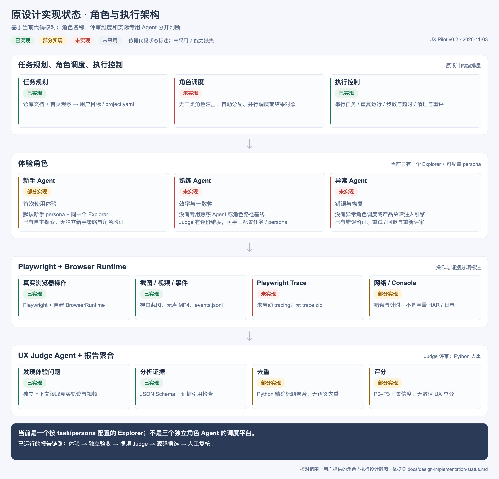
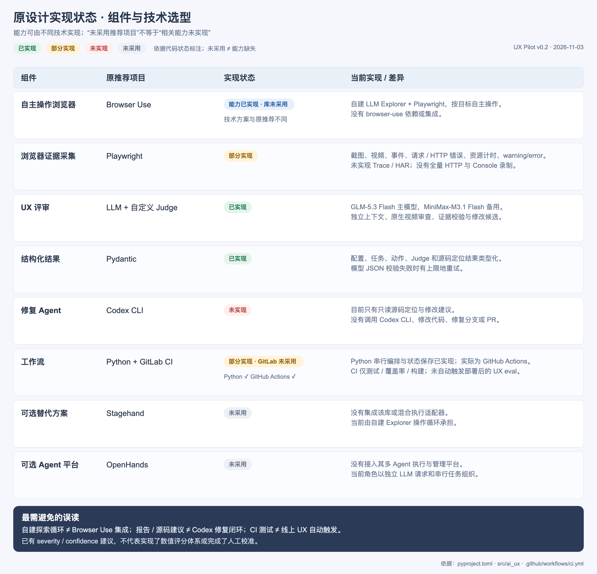

# 原设计实现状态对照

核对日期：2026-11-03。依据 UX Pilot v0.2 源码（`9b1da90`）逐项标注用户提供的两张设计图。**当前交付是目标驱动的浏览器体验、证据采集、独立验收、视频 Judge 和源码修改候选；三类专用角色调度与自动修复闭环尚未完成。**

图例：**已实现**＝对应能力在代码中可运行；**部分实现**＝只有设计的一部分；**未实现**＝没有该工作流；**未采用**＝没有集成这个可选技术，不表示相关能力一定缺失。已有能力和所推荐的具体组件分别判断。

## 图 1：角色与执行架构

[PNG 原图](diagrams/design-roles-status.png) · [SVG 矢量版](diagrams/design-roles-status.svg)

| 原设计项 | 状态 | 当前实现 | 尚未实现 / 边界 | 代码依据 |
|---|---|---|---|---|
| 任务规划 | 已实现 | 仓库文档＋真实首页观察生成用户目标、预期结果与 `project.yaml` | 不生成固定点击脚本；规划质量仍需复核 | [discovery.py](../src/ai_ux/discovery.py#L67) |
| 角色调度 | 未实现 | `Task.persona` 是可配置文字，传入同一个 Explorer | 没有新手/熟练/异常三类角色注册、路由、自动分配、并行调度或结果对比 | [schema.py](../src/ai_ux/schema.py#L121)、[agent.py](../src/ai_ux/agent.py#L350) |
| 执行控制 | 已实现 | 按任务/尝试顺序运行，限定步数、时间、模型调用数；记录停止、超时、连续操作失败及清理 | 当前为串行编排，不能表述成多 Agent 并发平台 | [agent.py](../src/ai_ux/agent.py#L192)、[llm.py](../src/ai_ux/llm.py) |
| 新手 Agent：首次使用体验 | 部分实现 | 默认 persona 为“第一次使用产品的普通用户”，Explorer 根据页面自主探索 | 没有独立新手 Agent 类、专门策略或真人标注的角色行为验证 | [schema.py](../src/ai_ux/schema.py#L124)、[explorer.md](../src/ai_ux/prompts/explorer.md) |
| 熟练 Agent：效率与一致性 | 未实现专用 Agent | Judge 有 `efficiency`、`consistency` 维度；可手工设置 persona/目标 | 评价维度不等于已存在熟练 Agent；没有熟练路径基线、角色专用策略与对照报告 | [schema.py](../src/ai_ux/schema.py#L229) |
| 异常 Agent：错误与恢复 | 未实现专用 Agent | 已有错误留证、有限模型重试/回退、重新评审、Judge `error_recovery` 维度 | 没有可调度的异常角色和产品故障注入任务引擎；开发测试中的故障替身不算产品能力 | [agent.py](../src/ai_ux/agent.py#L364)、[llm.py](../src/ai_ux/llm.py)、[tests](../tests/) |
| Playwright + Browser Runtime | 已实现核心执行层 | 隔离浏览器上下文、当前观察的目标 ID、有界 UI 操作、截图/录屏 | 仅有此层不能推导三类 Agent、Trace 或全网络录制已经完成 | [browser.py](../src/ai_ux/browser.py) |
| 真实浏览器操作、截图 | 已实现 | 点击、输入、选择、键盘、滚动、导航、刷新；每步视口截图 | 登录和复杂业务语义可能需要配置/适配器 | [browser.py](../src/ai_ux/browser.py#L289) |
| Playwright Trace | 未实现 | 有 `events.jsonl` 和视频，可追踪部分动作与页面变化 | 未调用 `context.tracing.start/stop`，不生成 `trace.zip`，不能宣称可用 Trace Viewer 回放 | [browser.py](../src/ai_ux/browser.py) |
| 网络日志 | 部分实现 | 请求失败、HTTP ≥400、资源计时、WebSocket 错误/元数据；DuckKing 适配有限业务消息 | 没有全量 HTTP 请求/响应、headers/body 或 HAR；结束时 Resource Timing 只保留最多 200 项 | [browser.py](../src/ai_ux/browser.py#L129)、[browser.py](../src/ai_ux/browser.py#L436) |
| UX Judge：发现问题、分析证据 | 已实现 | 新上下文读取原生视频/分段视频、轨迹与私有验收；校验 JSON、证据引用 | 结论是候选，不能代表真人研究；Judge 与 Explorer 可以使用同一供应商模型 | [agent.py](../src/ai_ux/agent.py#L47)、[judge.md](../src/ai_ux/prompts/judge.md) |
| 去重 | 部分实现 | 报告层按 `task_id + category + 规范化标题` 精确聚合，记录重复次数 | 去重由 Python `report.aggregate` 执行；没有语义去重、跨任务同根因聚类 | [report.py](../src/ai_ux/report.py#L10) |
| 评分 | 部分实现 | 输出严重度 `P0–P3`、证据置信度 `high/medium/low`、任务评审结论 | 没有统一数值 UX 总分、权重、基准校准或角色间量化比较；置信度不是统计概率 | [schema.py](../src/ai_ux/schema.py#L241) |

## 图 2：组件与推荐项目

[PNG 原图](diagrams/design-components-status.png) · [SVG 矢量版](diagrams/design-components-status.svg)

| 组件 | 原推荐项目 | 状态 | 当前对应实现 / 差异 |
|---|---|---|---|
| 自主操作浏览器 | Browser Use | **能力已实现；该库未采用** | 自建 LLM Explorer 循环＋Playwright。依赖中没有 `browser-use`；不能把现有循环叫作 Browser Use 集成。 |
| 浏览器证据采集 | Playwright | **部分实现** | 真实截图、录屏、页面快照、请求/HTTP 错误及资源计时；Console 收集 warning/error，另有 pageerror。**没有 Trace、HAR、全量 Console/网络录制。** |
| UX 评审 | LLM + 自定义 Judge | **已实现** | GLM-5.3 Flash 主、MiniMax-M3.1 Flash 备用，独立请求上下文，原生视频审查、事实/推断/建议分离、证据校验。 |
| 结构化结果 | Pydantic | **已实现** | 配置、任务、动作、Judge 输出及源码定位结果都有 Pydantic 契约，模型输出不合规时有限重试。 |
| 修复 Agent | Codex CLI | **未实现** | 当前只读定位源码和给出修改建议；没有启动 Codex CLI、修改业务代码、创建修复分支或 PR。 |
| 工作流 | Python + GitLab CI | **部分实现；GitLab CI 未采用** | Python 已完成串行编排、状态/证据保存、停止与重评。实际 CI 是 GitHub Actions，仅运行 lint、离线测试、覆盖率和 build；**不会在 Preview 部署后自动触发线上 UX eval**。 |
| 可选替代方案 | Stagehand | **未采用** | 没有依赖、适配器或混合执行接入；当前使用自建循环。 |
| 可选 Agent 平台 | OpenHands | **未采用** | 没有接入其多 Agent 执行与管理能力。 |

依据：[依赖清单](../pyproject.toml)、[模型默认配置](../src/ai_ux/defaults.py)、[编排器](../src/ai_ux/agent.py)、[CI 工作流](../.github/workflows/ci.yml)、[源码定位](../src/ai_ux/source_map.py)。

## 当前图应怎样读

- “新手 / 熟练 / 异常 Agent”在原设计中是目标形态；当前只有一个按 task/persona 配置运行的 Explorer，没有三种专用角色调度。
- 证据能力应写为“截图 / 视频 / 事件 / 部分网络和 Console”，不能包含已实现 Trace 的暗示。
- Judge 负责 UX 判断，Python 报告层负责精确去重；严重度建议不等于数值评分体系。
- 现有 GitHub Actions 验证的是 UX Pilot 自身的软件质量；它不自动评测新部署产品，也没有后续 Codex 修复闭环。

本次仅做状态标注和文档校正，没有因标注新增上述未实现功能。两张标注图根据设计内容重绘，不包含用户截图中的其他页面信息。生成脚本为 [render_design_status.py](../scripts/render_design_status.py)，内容源为 [design-status.json](diagrams/design-status.json)。
