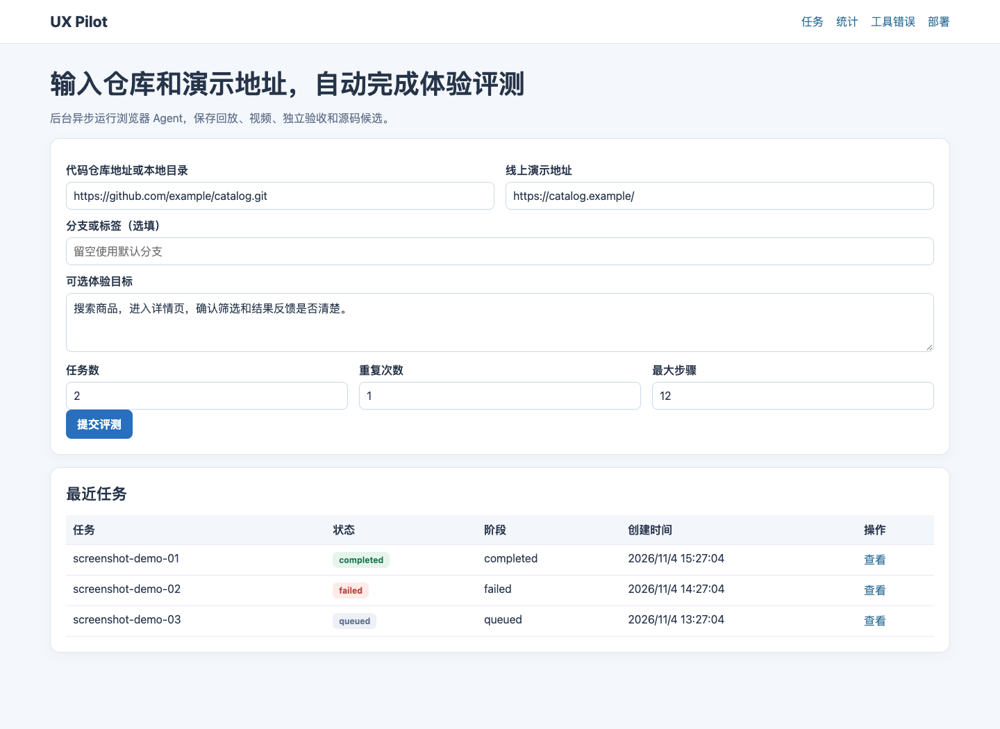
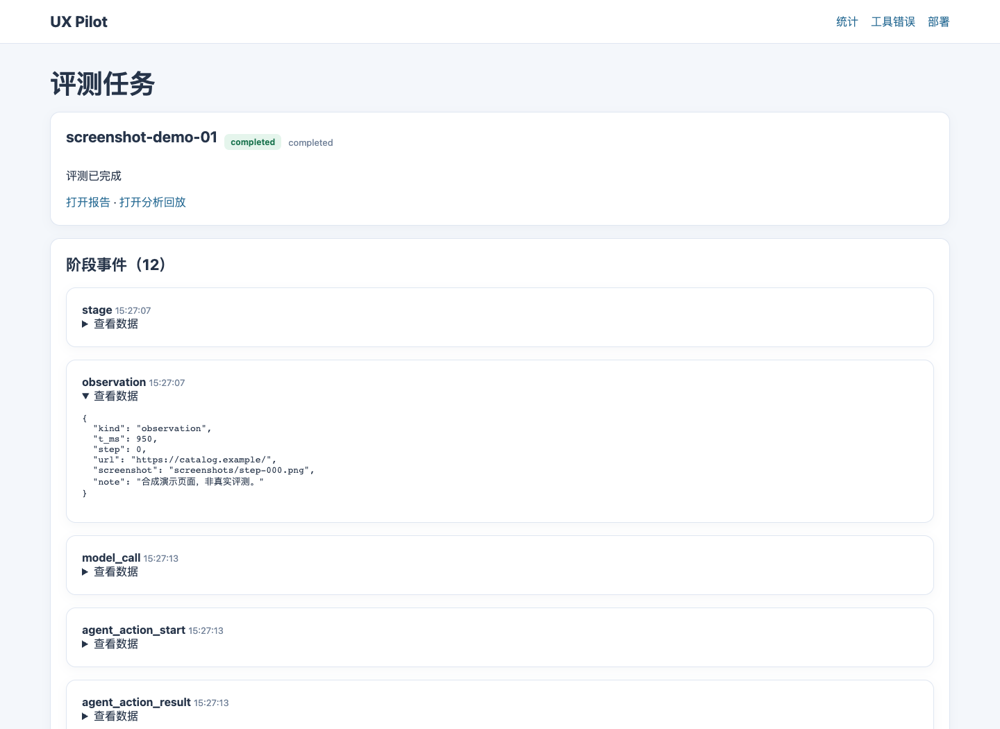
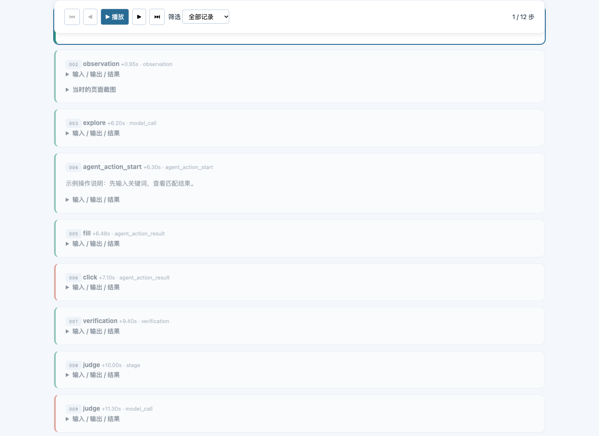
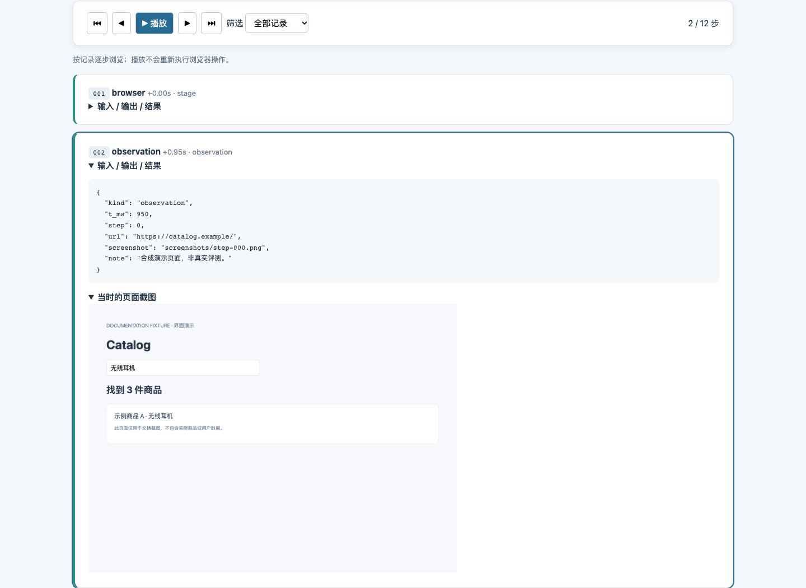
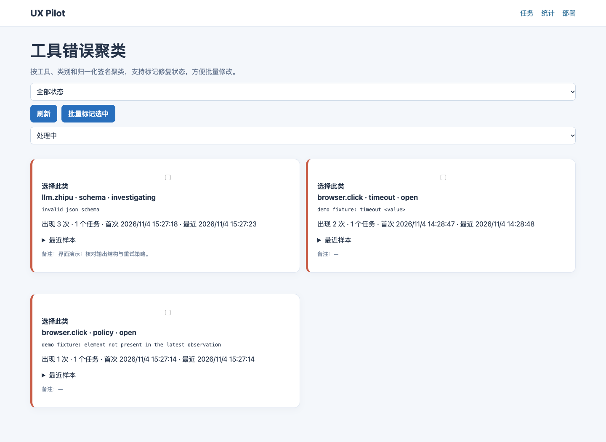
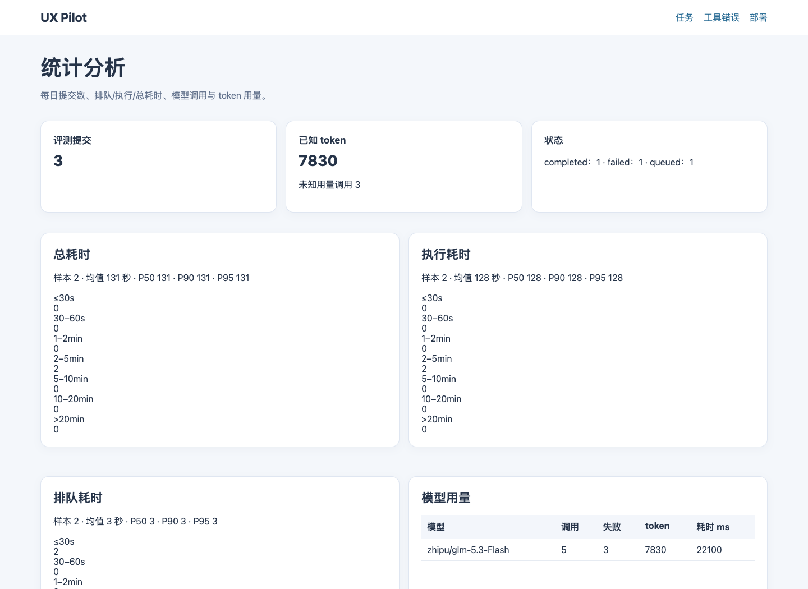
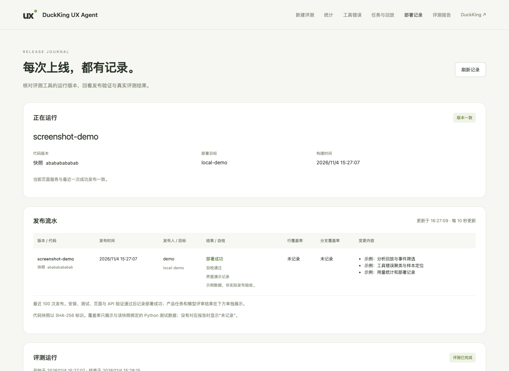
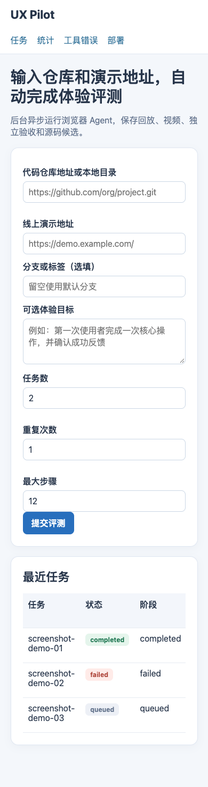
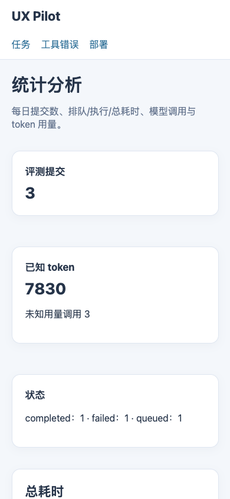

# Web 界面截图

这些图片由真实 UX Pilot 页面渲染，使用独立临时数据库中的**合成演示数据**。任务、错误、用量、时间和部署记录均用于说明界面，不代表线上评测结果或性能。截图不包含 API Key、私有运行证据或生产数据库内容。

桌面视口为 1440 × 1050，手机视口为 390 × 844。截图包括原版工作台以及 jfcs62 的兼容部署记录页。

## 首页与任务管理

输入仓库、网站和体验目标，查看队列与任务状态。



任务详情保留阶段事件，并提供报告、分析回放和取消入口。



## 分析回放

按记录逐步浏览，支持播放、前后切换和事件类型筛选。播放不会重新执行浏览器操作。



展开步骤可以查看输入、输出及页面截图。



## 错误聚类与统计

工具错误按工具、类别和归一化签名聚合，可筛选状态、批量标记并查看样本。



统计区分排队、执行和总耗时，并分别显示已知与未知模型用量。



## 部署记录

jfcs62 兼容页面展示运行版本、发布历史、验收、覆盖率及增量变更。图中的 `screenshot-demo` 是界面演示记录。



## 手机布局

| 首页 | 统计 |
| --- | --- |
|  |  |

## 重新生成

```bash
uv sync --frozen
uv run playwright install chrome
uv run python scripts/capture_workbench_screenshots.py
```

脚本启动临时本地预览，worker 数量为 0，只注入演示记录；不会提交真实评测、克隆仓库、调用模型或访问目标网站。完成后关闭浏览器和预览服务，移除临时数据库。日期以生成时刻为基准，避免示例过期后被统计时间窗过滤。
